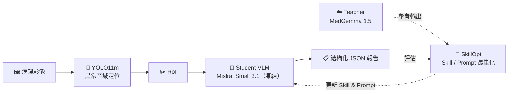

### 👋 嗨，我是 **呂建篁 Jian-Huang Lyu**

成大電機（資工組）碩士生 · 專注 **電腦視覺**、**多模態 AI** 與 **醫學影像分割** · 📍 Tainan, Taiwan

---

## 🧑‍💻 About Me

- 🎓 **國立成功大學** 電機工程學系（資訊工程組）碩士生，預計 **2027** 畢業
- 🔬 研究方向：醫學影像處理、LLM / VLM 醫療應用、電腦視覺
- 🧫 碩士論文：**IHC 染色醫學影像病灶分割**
- 🤝 與 **Google** 合作：病理影像視覺屬性生成與篩選
- 🏢 2026 **國網中心（NCHC）** 暑期實習：自主提案並獨立完成病理影像結構化分析系統
- 💼 正在尋找：**AI/ML、電腦視覺、LLM/VLM 應用研發工程** 職缺
- 🏃 累積 10 年跑齡，2026 古都馬拉松 10K 總排名 **121 / 10,285**

---

## 🛠️ Tech Stack

| 類別 | 技術 |
|:--|:--|
| 💻 **Programming & Tools** |   -4B5563?style=flat-square) |
| 👁️ **AI / Computer Vision** |        |
| 🤖 **LLM / VLM Application** |      |
| ⚡ **Edge AI & Optimization** |     |
| 🌐 **Backend & Deployment** |     |
| 🧪 **Evaluation & Testing** |     |

---

## 🚀 Featured Projects

### 🔬 病理影像異常區域定位與結構化分析系統

> 🏢 **國網中心（NCHC）暑期實習** · 2026/07 – 2026/08 · 💡 自主提案、兩個月內獨立完成

為降低醫師逐張閱片、標註與撰寫報告的時間成本：先以 YOLO 定位病理影像異常區域，再由地端 VLM 針對預測區域產出**結構化分析報告**。採用 **Teacher–Student 框架**，以雲端醫療模型 MedGemma 1.5 為 Teacher，在**凍結權重、不微調**的前提下，以 Microsoft SkillOpt 概念把 Skill 與 Prompt 當作「文字形式的可訓練參數」來最佳化。

| 📊 指標 | 🔢 結果 |
|:--|:--|
| 🎯 **YOLO11m 定位**（RefPath，9 種 YOLO 中最佳） | Recall **81.7%** · mAP50 **86.6%** · mAP50–95 **72.6%** · F1 **0.792** |
| ✅ **Schema Validity** | 10.83% ➜ **99.29%** |
| 🚫 **Schema 違規案例** | 12,006 ➜ **95** |
| 📈 **Soft Score**（Mistral Small 3.1） | 0.0190 ➜ **0.1942** |
| 🧩 **Field Similarity** | 19.50% ➜ **27.09%** |
| ⏱️ **單張影像端到端** | 定位 + 報告 **< 5 分鐘** |

> 💡 實驗發現：SkillOpt 對結構化能力較弱的模型效益最顯著；本身已具高結構化能力的 Gemma4 31B（baseline Soft Score 0.4272）則幾乎沒有提升。

---

### ⚡ NVIDIA Jetson Xavier NX 邊緣 AI 即時風格轉換系統

> 🎓 成大電機「人工智慧於數位訊號分析之應用」課程 · 2026/04 – 2026/05 · 👑 **專案負責人（7 人團隊）**

使用 **AdaIN**（Arbitrary Style Transfer, ICCV 2017）預訓練模型，完成 ONNX 轉換 → TensorRT **INT8 PTQ** 量化 → Jetson 整合部署，支援單張影像與即時 Camera 推論。負責專案規劃、架構設計與分工，並撰寫 Docker 容器化部署文件供團隊使用。

| 📊 指標 | 🔢 結果 |
|:--|:--|
| 🚀 **INT8 vs FP32**（Xavier GPU, 512×512） | 0.3307 s ➜ **0.1295 s**（**2.55×** 加速） |
| 🖥️ **vs CPU FP32** | 約 **60×** 加速 |
| 📦 **TensorRT Engine 體積** | 47.8 MB ➜ **9.7 MB**（約 **−80%**） |
| 🎥 **即時 Camera Demo** | **7.7 FPS** |

---

### 😮 多模態即時微表情辨識系統 🏆

> 🎓 臺南大學資工系畢業專題 · 2022/01 – 2022/12 · 🥉 **畢業專題第三名** · 負責資料處理、模型實驗與系統整合

透過攝影機即時偵測人臉，辨識 **正向 / 負向 / 驚訝 / 其他** 四類微表情。以 MediaPipe Face Mesh 裁切對齊人臉，**CNN** 擷取 Onset / Apex 靜態外觀特徵、**TV-L1 光流 + Inception** 擷取動態運動特徵，再以 **Self-Attention** 學習各類別特徵，前端以 PyQt5 實作 GUI。

| 📊 指標 | 🔢 結果 |
|:--|:--|
| 🎯 **CASME Accuracy** | **80.05%** |
| 🧪 **Composite Dataset Accuracy** | **72.33%** |
| 📈 **vs Feature Refinement baseline** | CASME II **+4.4** · SAMM **+1.9** · SMIC-HS **+5.1** 個百分點 |
| 🔍 **Ablation**（移除光流 + Inception） | 72.74% ➜ 48.62%，驗證動態分支的關鍵貢獻 |
| ✔️ **評估方式** | LOSO 交叉驗證 · 4 個獨立資料集 + Composite Dataset |

---

## 🎓 Education

| | 學校 | 學位 / 系所 | 期間 |
|:--:|:--|:--|:--|
| 🏛️ | **國立成功大學** NCKU | 碩士 · 電機工程學系（資訊工程組） | 2025/09 – 至今 |
| 🏫 | **國立臺南大學** NUTN | 學士 · 資訊工程學系 | 2020/09 – 2024/01 |

---

## 📅 Activities & Experience

| 日期 | 活動 | 角色 / 成果 |
|:--|:--|:--|
| 🏢 2026/08/28 | 國網中心 2026 暑期實習成果發表會（新竹） | 簡報發表與系統 Demo |
| 🔬 2026/07 – 08 | 國網中心（NCHC）暑期實習 | 病理影像結構化分析系統 |
| 🏃 2026/03/01 | 2026 古都馬拉松 10K | 總排名 **121 / 10,285** |
| 🧬 2025/08/20 – 22 | IEEE CIBCB 研討會 | 工作人員（貴賓引導、活動攝影） |
| 🎡 2025/08/08 – 10 | AI 人才培育成果展《智慧遊樂園：AI 奇幻之旅》 | 展覽工作人員（攝影、攤位協助） |

---

## 📊 GitHub Stats

---

### 🤝 歡迎交流 AI / CV / LLM 應用與合作機會！

⭐ 感謝來訪，喜歡的專案歡迎給顆星 ⭐

